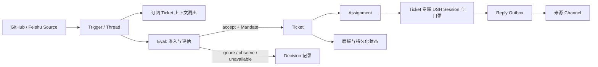

# DeepSeek Super-agent 原型与设计文章研究报告

## Summary

Super-agent 设计试图让人们在熟悉的工作渠道中，把多项工作交给持续在线的 Agent，减少手动维护 Session、传递上下文和跟进执行的负担。原文同时讨论个人助手和团队研发协作；公开的 `dsh-superagent` 则聚焦一个团队共用 Agent、处理单个 GitHub 仓库及可选 Feishu 消息的研究场景。它的目标涵盖多人协作中的任务执行，并非仅帮助一个人管理更多 Session。

**组织决定目标、决策权和责任，技术承接并执行这些安排。** 原型对事件准入、任务授权、独立执行和恢复的建模具有参考价值；任务路由与共享上下文并不自行产生业务优先级、冲突裁决权或验收责任。评价价值应考察团队完成获认可工作的总成本，包括审核、纠错和维护，不能只看 Agent 并发数或消息数量。

公开原型不等于文章描述的内部实现。文章中的 Chain of Recall、Speculative Execution、云端无状态 Loop、端侧 BYOM daemon 和进度型 Watchdog，不能从原型推定为已实现。其本地 SQLite、单进程锁、危险权限 preset 和单仓库部署假设适合在研究或受信任环境中评估，不能直接当作多租户 Cloud Agent 的生产架构。

## Table of Contents

- [研究范围与证据等级](#研究范围与证据等级)
- [原型解决的问题](#原型解决的问题)
- [组织安排与技术职责](#组织安排与技术职责)
- [原型架构与执行过程](#原型架构与执行过程)
- [公众号文章与公开原型的差异](#公众号文章与公开原型的差异)
- [对 DSH 的参考价值](#对-dsh-的参考价值)
- [后续核查索引](#后续核查索引)
- [如何评价团队收益](#如何评价团队收益)
- [采用建议与验证路线](#采用建议与验证路线)
- [局限与未验证事项](#局限与未验证事项)
- [来源](#来源)
- [Dev Note](#dev-note)

-----

## 研究范围与证据等级

研究对象是 `dsh-superagent-prototype` checkout 中的 `dsh-superagent` 0.1.0 bundle，以及 DeepSeek Harness 团队于 2026-10-31 发布的文章《Super-agent 设计探索：迈向更自主的 Agent 系统》。原型 README 明确说明：公开版本经过发布适配，与内部版本和文章描述的实现不完全相同，文章中的部分设计只是未来方向；该项目仅供研究参考，不是正式产品，也未声明生产就绪。

原型仓库没有收录文章全文。为减少微信页面不可访问或删除带来的引用风险，文章可见正文和 15 张配图已整理在[本地引用副本](reference-materials/super-agent-design-exploration.md)；该副本记录了原文链接、账号、署名、页面日期和整理说明。转录为可检索的 Markdown，图片以 WebP 保存；有格式或内容差异时以原文页面为准。

本文区分三类陈述：原型实现事实依据其源码与项目文档；文章设计与实验依据文章原文；与 DSH 当前架构的映射属于分析判断，不表示相关能力已成为 DSH 产品功能。本文对原型做了源码和文档阅读，没有运行其 `pnpm check`、真实 GitHub/Feishu 集成或文章实验，也没有执行 DSH 产品测试。

## 原型解决的问题

原文从“一个人通常只能同时跟进 3 到 5 个活跃 Session”的观察出发，讨论单会话设计对多任务的限制；但它在第 1 节和结语都将应用范围扩展到个人助手与团队研发协作。这里至少有三个不同层次的问题：

| 层次 | 要回答的问题 | 原文与公开原型的关系 |
|---|---|---|
| 个人多任务 | 一个人如何少切换 Session，同时跟进多项工作？ | 是原文的出发点和适用场景之一；双层架构、上下文召回与异步交互主要回应这些技术约束。 |
| 团队共用 Agent | 多人如何从不同渠道发起、补充和验收任务，让 Agent 连续执行？ | 是原文的实际研发场景，也是公开原型聚焦的单仓库应用。任务存在多个请求者和信息来源，不能按单个用户的偏好理解全部指令。 |
| 公司组织安排 | 做什么、谁有权决定、资源如何分配、冲突由谁裁决、结果由谁负责？ | 由组织决定；文章没有给出完整组织制度，公开原型也不是公司治理系统。采用技术需要接入这些安排。 |

原型接收 GitHub issue、评论、Pull Request 和可选 Feishu 消息；识别明确请求或符合团队规则的主动候选；为获准任务建立 Ticket；在该 Ticket 的独立 DSH Session 和工作目录中执行；再将确认、问题或结果发回原始对话。管理面板呈现需要人工判断的候选、任务、来源状态和配置。这些机制承担的是持续执行和协调中的具体工作。

项目把目标概括为尽量少花费人的注意力，同时让 Agent 提供更多价值。其 `docs/000-philosophy.md` 同时要求运营者对发给同事的消息负责，避免批量 Pull Request、广播和无价值工作，并从窄授权和观察模式开始。因此，“减少注意力成本”应理解为减少操作性负担，让人把精力用于判断和责任；该目标本身不能证明人的总投入已经减少。

## 组织安排与技术职责

共享 Agent 进入的是已经存在的人际协作关系。哪些问题值得处理、谁能改变需求、谁批准交付，来自团队的工作安排；系统可将其表示为来源配置、Policy、任务指令、审批要求和操作记录。规则需要有人制定、解释和维护。某项安排暂时不明确时，可以缩小 Agent 的委托范围，并把无法按现有规则处理的事项交回有权决定的人。下表是采用时的职责分配建议，不表示原型已对每项安排提供强制机制。

| 事项 | 组织作出的决定 | 技术可以承担的职责 |
|---|---|---|
| 目标与优先级 | 选择工作、确定先后与资源投入。 | 按给定规则筛选事件、排队和限制并发，展示积压与执行成本。Router 的调度顺序本身不构成业务优先级。 |
| 请求与授权 | 确定谁能提出、修改或取消何种工作。 | 校验配置的主体与来源，记录请求和 Mandate，执行相应限制；允许发起任务不意味着可以批准一切后续操作。 |
| 意见与冲突 | 指定决策者，确定不同要求冲突时的处理方式。 | 保留要求及其来源；已有规则足以决定时按规则执行，规则不足时把冲突交回指定负责人。信息汇总不能自行赋予裁决权。 |
| 上下文与保密 | 确定哪些信息可对谁、在哪项工作中使用。 | 按允许范围提供上下文并执行访问控制。部署一个共享实例不能代替信息共享决策。 |
| 交付与责任 | 明确完成标准、验收人和结果责任。 | 提供可审阅成果、验证证据和操作记录，支持人在必要时干预。模型报告完成或 Ticket 结束不自动等于业务验收。 |

技术设计也会反过来影响协作：默认向谁提问、先执行哪项任务、何时标记完成，都会改变人的工作负担和实际参与方式。这些默认行为需要被团队理解并认可。执行能力提高后，团队可能调整分工与流程；作出调整和承担责任仍然需要人，不能让未说明的技术默认值代替这些决定。

例如，两名都能发起任务的成员，分别要求同一接口“移除旧行为”和“保持兼容”。身份检查可以让两条请求都通过，Thread 路由可以让同一 worker 看见两项要求，但这两步没有回答谁能决定接口兼容政策。合理的处理要求来自既有决策安排：规则能解决时执行规则，否则把互斥部分停在可审阅状态，提交指定负责人决定。这是本文的采用建议，不是已验证的原型冲突处理保证。

原型对主动接单已有方向约束：`src/policy.ts` 的 `directionAllowed` 要求评估结果表明存在实施请求、目标已有依据且无需未决设计决策，否则 `assessmentOutcome` 拒绝接受候选。Host 检查这些结构化字段，方向是否明确仍依赖模型评估及其证据；这不构成解决设计分歧或确认业务决策权的独立机制。

原型已经区分了一部分技术职责。`docs/002-authorization.md` 说明上下文订阅不授予新权限，Mandate 保存任务获准的依据；`docs/003-execution.md` 则说明合并要求由提示词描述，Host 没有合并专用决策逻辑，强制审批需要 GitHub 分支保护。因此，授权依据被记录、模型被告知审批要求、远端系统强制审批，是三种不同保证。

原文也承认这些设计的适用范围：第 8.2 节将任务呈现、中途干预和接管列为开放问题；第 8.3 节明确由组织决定上下文共享与隔离范围。公平的评价应承认它解决的执行和协调问题，同时检查它能否服从现有组织安排；不能把公司治理列为这个研究原型应独立解决的技术功能。

## 原型架构与执行过程

原型的核心是应用层领域模型，而非某个特定的 Prompt。源码在 `src/core/` 中定义同步事务内的 Engine 和领域逻辑；`src/app/runtime.ts` 负责组装存储、策略、评估器、执行器、来源和后台效果；GitHub、Feishu 和客户端面板分别处于外围适配层。

几个关键概念各自承担不同责任：

| 概念 | 在系统中的职责 | 不能据此推导的能力 |
|---|---|---|
| `Source` / `Trigger` | 接入外部消息并保留来源标识、作者、线程及来源元数据；来源适配器负责事件读取和过滤。 | 所有接入事件都自动成为模型输入或任务。 |
| `Thread` / `Eval` | 按来源线程组织事件；同一线程的待评估 Trigger 可合并处理，避免每条闲聊都启动独立评估。 | 全组织事件有一个全局、无限上下文。 |
| `Policy` / `Mandate` | 用确定性规则判断主体、来源、请求强度和主动规则；获准 Ticket 保存授权依据，并可在策略变化时重验。 | DSH 工具权限、操作系统权限或租户安全隔离。 |
| `Ticket` / `Assignment` | 将任务生命周期与执行尝试分开；Ticket 持有订阅、输入、状态和授权，Assignment 记录一次执行。 | 一个 Ticket 就是分布式任务队列或跨节点租约。 |
| Worker Session / directory | 每个 Ticket 使用专属 DSH Session 和工作目录，避免并行任务共享同一段工作对话或工作树。 | 独立 Session 等同进程、容器或操作系统隔离。 |
| `Channel` / Outbox | 用原始对话地址投递确认、提问和结果，并用持久回执与效果队列处理外部发送。 | 数据库事务与 GitHub/Feishu 的远端副作用形成原子事务。 |

**接入与准入。** `src/core/intake.ts` 和 `src/core/evals.ts` 将来源消息转成 Trigger，并按 Thread 归集评估。明确 @ 机器人或允许的请求可直接进入授权判断；推断出的主动候选依赖启用的 admission 规则。默认 `observe` 模式会记录“若启用自动接单，本来会接受”的评估结果，但不因此启动 worker；自动接纳需要管理员选择 `auto` 并配置匹配规则。模型评估负责解释证据和意图，不能单独创设授权。

**路由与上下文。** Thread 上新事件可以扇出给已经订阅该 Thread 的 Ticket worker；发给正在处理相关 Ticket 的人的后续消息可由 worker 接手。Ticket 也能跟随额外 Thread 获取上下文，或拒绝无关 Thread。上下文订阅和任务 Mandate 是不同关系：订阅让信息可见，不自动授权新的工作。未被 Ticket 接手的消息进入 Eval，而不是让所有 worker 读取所有会话。

**隔离与执行。** 接受后，Engine 在一次领域事务中创建带 Mandate 的 Ticket、初始 Assignment 和必要订阅，然后由 `src/executor/dsh.ts` 在 DSH Session 中运行。Ticket ID 决定 worker Session ID；每个 Ticket 绑定自己的工作目录。新消息作为 Input 交付给该 Session，并分别记录已投递、已读等状态。一次失败重试会产生新的 Assignment，但继续受原 Ticket 的 Mandate 约束。

**持久化与效果。** `src/app/store.ts` 使用本地 SQLite 保存领域状态；`src/app/effects.ts` 通过持久效果表调度带退避的后台工作；`src/app/outbox.ts` 在记录消息回执时排入发送效果，避免发送成功但本地未记账时简单重发。Runtime 使用本地锁防止同一状态目录的多个实例同时运行。它提供的是单机重启恢复纪律，不是多副本 HA、跨数据库事务或通用 exactly-once 投递。

**恢复与人工关注。** Host 重启时，执行器检查未完成 Assignment；中断在执行中间的任务会带恢复提示继续，已报告等待、完成、阻塞或失败且期间没有新输入的任务可保留原 Session。恢复提示要求先检查工作树、Git 历史和 GitHub 状态，避免重复已经完成的外部操作。健康状态、失败交付、待处理问题和面板为运营者提供可见性；这些机制不等同于文章所说的外部 Watchdog 根据“任务是否取得进展”重启 Loop 或重分配资源。

## 公众号文章与公开原型的差异

文章把 Super-agent 归纳为连续、高效、主动、持久四个特征，并提出一套可能适用于个人助手和研发 Agent 的通用架构。公开原型证明团队发布了一个围绕该方向的可运行研究项目，但 README 明确限制了两者之间的等同关系。下表按文章所述设计逐项核对公开原型：

| 文章设计或主张 | 公开原型中可核实的对应物 | 判断与边界 |
|---|---|---|
| Router 与 Worker 双层架构 | 常驻主 Session 负责团队交互、候选评估及任务协调；Ticket worker 在独立 Session/目录中执行获准工作。 | 有相近的职责划分；原型围绕 GitHub/Feishu 和 Ticket 生命周期，不是通用消息 Router。 |
| 事件过滤与 Thread 路由 | Source 过滤、Trigger 去重、Thread 上批量 Eval、已订阅 Ticket 上下文扇出。 | 这是原型已实现的重要部分，且有显式领域状态和策略规则。 |
| Chain of Recall | 持久化 Thread、Ticket、Mandate、输入及会话引用，主 Session 可以检查已记录任务或把信息作为 Input 交给 worker。 | 未发现文章所述的多跳、Inline/Spill 一体化链式召回机制；有可查询的持久事实不代表已经实现该检索策略。 |
| Speculative Execution | `observe` 可记录主动评估结论，管理面板可展示待人工判断的候选。 | 观察模式不启动编码 worker，因此不是“先做一份可能有用的工作，再决定是否提交”的投机执行。 |
| 多信道全双工交互 | GitHub 与可选 Feishu 共用 Ticket 状态；原始来源 Channel 接收回复；Ticket worker 可继续处理后续消息。 | 有跨渠道任务连续性，但不代表任意 IM、邮件、日程和代码平台都已支持，也不证明交互可在所有执行步骤中实时插入。 |
| 计算、状态和执行环境分离 | 领域状态、Session、工作目录和外部效果有不同职责；但部署文档描述的是本地运行时和状态目录。 | 组件职责有所分离，尚非文章建议的云端无状态 Loop + 独立端侧 daemon + 跨设备凭据/执行协议。 |
| Watchdog | 进程健康、效果重试、Assignment 恢复和人工重试路径。 | 未找到外部、独立的进度观察进程；健康检查不判断模型是否推进任务，也不自行接管卡死任务。 |
| 合成负载性能实验 | 文章报告双层架构等方案的初步对照结果。 | 原型仓库未包含可复现该文章实验的同口径实验项目；文章自己说明编码工具只消耗时间、每种方案运行 5 次。 |

文章端到端实验使用群聊与 GitHub CI 消息流，每轮约 300 条消息、约 20 条工作请求，每种方案运行 5 次；编码执行由纯耗时工具模拟，而不是实际代码修改或评审。文章报告 Super-agent 的任务完成时间 p50/p95 为 12.4/15.7 分钟；中性提示的单 Session 方案没有一次调用 Subagent，p95 为 29.5 分钟。图表说明消息间隔和工作时长按 1/4 缩放，而模型调用耗时使用真实值。单独的 Router 压测把 Trigger 速率从每分钟约 1 条提高到约 40 条，平均 batch 从 1.0 增至 2.8，单次请求耗时从 2.5 秒增至 3.9 秒，分摊到单个决定的推理时间从 6.4 秒降至 1.6 秒。这些数字说明文章报告的合成负载调度结果，不能外推为生产任务吞吐、代码质量、真实并发能力或成本结论；公开原型仓库也没有找到可复现这些实验的同口径项目。实验未测量多人决策、真实代码审核和返工成本，因而不构成团队生产力改善的直接证据。

## 对 DSH 的参考价值

DSH 已提供 Agent Loop、Session event log、工具生命周期、Preset、Subagent、Jobs、Schedule 和插件扩展点；它也有独立的 Cloud Agent、租户隔离、durable workspace 和 Agent 协作研究。因而该原型更适合作为“应用如何使用 DSH 组成事件驱动任务系统”的案例，而不是要求 DSH 核心直接增加一个 Super-agent Loop。可参阅[云端 Agent 架构建议](dsh-cloud-agent-architecture-recommendation.md)、[云端 SaaS Agent 研究](dsh-cloud-saas-agent-research.md)、[部署与租户隔离参考](dsh-deployment-and-tenancy-deep-dive.md)、[Agent 管理与 Watchdog 研究](dsh-herdr-agent-management-research.md)及[Agent 协作研究](dsh-agent-collaboration-research.md)。

| 研究面向 | 原型提供的具体参考 | 对 DSH 的判断 |
|---|---|---|
| 应用领域状态 | Ticket、Mandate、Assignment、Thread、Decision 记录任务身份、授权理由和执行进度。 | 可由 DSH 外围业务插件或 Control Plane 持有；Session log 适合记录模型交互事实，不能替代业务任务账本。 |
| 事件到工作流 | 先做来源级过滤和确定性策略，再让模型辅助评估；把 Thread 事件批处理，并只送达订阅相关的 worker。 | 可与 DSH 的事件和工具扩展机制组合；事件过滤、路由和授权属于应用策略，不能只靠系统提示词。 |
| Agent 上下文组织 | 主 Session 协调，Ticket 专属 Session 执行；线程订阅只提供相关上下文，工作权由 Mandate 表示。 | 与 DSH Session/Agent 组合相容，但身份、生命周期、持久化和并行额度须由宿主应用定义。 |
| 持久效果 | 域状态事务内排入外部效果，发送端以 Outbox 记回执并重试。 | 可用于提醒和消息等副作用；远程系统拒绝、已提交、结果未知必须分别表示，不能把重试误当幂等保证。 |
| 可观察性 | 面板聚焦等待人工决策的候选、Ticket、失败交付和来源健康。 | 有助于把 Agent 状态呈现为可操作队列；还需区分“Agent idle”“需要人”“执行失败”和“已完成”。 |
| 执行安全 | 原型假定单团队可信仓库和本地 Agent 运行环境。 | 不能作为 DSH 多租户隔离方案；Session ID、Preset 和应用授权不等于 OS sandbox 或凭据隔离。 |

最重要的概念区分是**授权与执行权限分层**。Mandate 回答“这个外部请求是否允许形成一项工作，以及允许在什么理由下继续”；DSH Permission Preset 和工具审批回答“Agent 能调用哪些能力，以及具体调用是否需要审批”。两者相互补充，任何一个都不能代替另一个。特别是自动处理外部事件时，事件发送者、仓库/组织规则、任务 Mandate、工具调用授权和操作系统权限要分别审查。

对 DSH 的采用还需要应用方提供业务决策依据。通用 Harness 可以承载身份、工具审批、事件记录和执行限制；业务应用负责连接既有负责人、审批与任务系统，解释当前工作受哪些决定约束。不能因为主 Session 能协调 worker，就把它视为拥有公司管理权限的角色。

## 后续核查索引

本轮源码核查把“运行事实”和“外部方案评估”拆到[运行事实、BYOM 模型与企业化差距](dsh-superagent-runtime-facts-and-enterprise-gap.md)：其中列出 Router/Worker 同进程证据、端侧 daemon 与控制面缺失、隔离分层判断、开源方案逐项结论和三项可验证的下一步。

本文关于团队收益评价与采用建议的结论保持不变；若后续需要核对进程边界或判断开源替代，先读上述新文档，再回到本文的组织责任分析。

## 如何评价团队收益

“人的注意力”包括不同人的不同投入。请求者少切换 Session，如果换来维护者更多值守、评审者更多筛选无效 PR，团队总成本可能上升。自主执行也可能提高成果产生速度，使审核和决策成为新的积压点。以下是后续真实场景评估建议，不是本文已有的实验结果：

| 评价项 | 建议观察的证据 | 单看什么会误判 |
|---|---|---|
| 有效交付 | 在相近任务难度与质量要求下，被指定验收人接受并实际采用的成果，以及交付周期。 | Ticket 结束数、PR 数、并行 worker 数。 |
| 团队人工投入 | 请求、上下文补充、决策、审核、返工、故障处理和配置维护所用时间，并记录主要参与者的中断情况。 | 请求者操作次数或机器人发消息次数。 |
| 审核与决策负担 | 等待审核或决定的积压、等待时长、被退回和放弃的工作，以及非计划任务占用。 | 只测 worker 执行耗时，把等待人的时间排除。 |
| 工作可控性 | 冲突、停止、需求改变和失败时，能否找到依据与负责人，并按现有规则继续或交回人工。 | 有面板或日志就认定能够正确处置。 |
| 运行总成本 | 模型、执行资源、无效尝试和运营维护的投入。 | 用更多后台算力换更短延迟后，只报告延迟下降。 |

对比应使用相近任务、相同验收标准，并覆盖完整交付周期及受影响成员。原文所说的主动与低打扰可以作为设计目标，但少发通知不等于减少工作，后台静默执行也不等于没有资源成本。当审核积压增加时，应调整接单范围、主动规则或并行量，而不能仅以提高 Router 吞吐应对。

## 采用建议与验证路线

若要基于 DSH 探索相似产品，建议借用应用原则而非照搬部署形态：

1. **先确定工作委托，再选窄场景。** 沿用既有的工作负责人、优先级、验收标准和冲突处理方式，明确 Agent 承担哪段工作；以一个仓库或明确工作流开始，定义哪些事件会进入系统、何种身份可发起工作、主动规则由谁维护。对尚无明确决策安排的工作先缩小范围，并以观察模式记录主动候选。
2. **先定义持久领域记录。** 明确任务 ID、授权依据、来源事件 ID、执行尝试、待投递输入、外部副作用 receipt、停止与撤权语义。模型上下文和 Session 历史可以引用任务记录，不应成为唯一权威状态。
3. **为并行任务定义资源与上下文归属。** 决定何时为任务新建 Session/工作目录、如何限制同时运行数、跟进消息如何路由，以及停止任务时如何禁止迟到输入和继续写入。
4. **把外部副作用和恢复作为一等流程。** 为 GitHub 评论、Pull Request、CI 操作等定义幂等键、receipt、未知结果查询和人工接管；恢复前先核对远端状态，再允许重试。
5. **单独建立安全部署方案。** 公开原型部署文档指出其 preset 使用 `danger-full-access`，CLI wrapper 不提供进程隔离，进程以启动用户权限运行。多租户、用户提交的不可信仓库、凭据托管和任意代码执行必须另做威胁建模、sandbox 和网络出口限制。
6. **分别验证技术行为与团队收益。** 按 DSH 已有研究验证模型可见事实重建、任务独立恢复、receipt 去重、崩溃与超时区分，以及无授权事件无法启动执行；另用真实任务观察验收质量、团队总投入和审核积压。针对冲突指令、需求变更、停止与重新授权，检查结果是否符合团队已经确定的处理方式。

这些步骤是后续设计建议，不是本文已实现的 DSH 改造计划。现有 Cloud Agent 报告已经把 Control Plane、DSH Execution Plane、Executor、Workspace、Session ownership 和 handoff 列为不同职责；Super-agent 原型报告补充的是事件驱动任务、授权理由和人工注意力管理的具体应用例子。

## 局限与未验证事项

本次没有运行原型单元测试、类型检查、构建或真实来源接入，因此源码阅读能支持结构与机制判断，不能证明当前代码所有路径均正常工作。文章实验没有由公开仓库复现，亦未提供足以独立重建每次运行的事件、参数和原始结果；其性能数据应作为团队披露的初步证据，而非独立验证的基准。

原型面向一个团队和一个代码仓库，采用本地 SQLite 和进程锁；文档未建立跨节点调度、HA、租户级 OS 隔离、外部凭据隔离、跨仓库事务或任意 Agent 互操作的产品承诺。Feishu/GitHub Source 的可用性依赖相应帐号、网络、CLI 或 webhook 配置。未来评估生产适用性时，应针对部署环境实际运行权限和外部系统副作用做故障注入，而不是从“任务授权记录完整”推断系统安全。

本文没有访谈团队成员、观察长期真实协作或测量审核、决策及运营成本，无法判断实际使用中是否降低了团队总投入，也不能判断现有组织安排在该原型中被遵循的程度。本文对组织责任的分析用于限定技术结论的适用范围；它既不证明采用会改善组织运作，也不以缺少公司治理功能否定原型的研究价值。

## 来源

- [DeepSeek Harness 团队：《Super-agent 设计探索：迈向更自主的 Agent 系统》](reference-materials/super-agent-design-exploration.md)，公众号页面日期 2026-10-31；[原始页面](https://mp.weixin.qq.com/s/zoS7GlReWPhfCjENGxXCdg)。
- 原型仓库：`dsh-superagent-prototype`，重点阅读 `README.md`、`docs/000-philosophy.md`、`docs/001-domain.md`、`docs/002-authorization.md`、`docs/003-execution.md`、`docs/006-deployment.md` 和 `docs/007-architecture.md`。
- 主要实现入口：`src/core/engine.ts`、`src/core/intake.ts`、`src/core/evals.ts`、`src/core/tickets.ts`、`src/core/assignments.ts`、`src/policy.ts`、`src/app/runtime.ts`、`src/app/store.ts`、`src/app/effects.ts`、`src/app/outbox.ts` 和 `src/executor/dsh.ts`。
- DSH 对照材料：[云端 Agent 架构建议](dsh-cloud-agent-architecture-recommendation.md)、[云端 SaaS Agent 研究](dsh-cloud-saas-agent-research.md)、[部署与租户隔离参考](dsh-deployment-and-tenancy-deep-dive.md)、[Agent 管理与 Watchdog 研究](dsh-herdr-agent-management-research.md)和[Agent 协作研究](dsh-agent-collaboration-research.md)。

## Dev Note

本文是基于指定 checkout 和页面日期整理的研究草稿。若公开原型、文章归档或 DSH 当前架构发生变化，应重新核对对应源码和实验材料；不要将文章中的内部系统描述自动视为公开原型现状。
